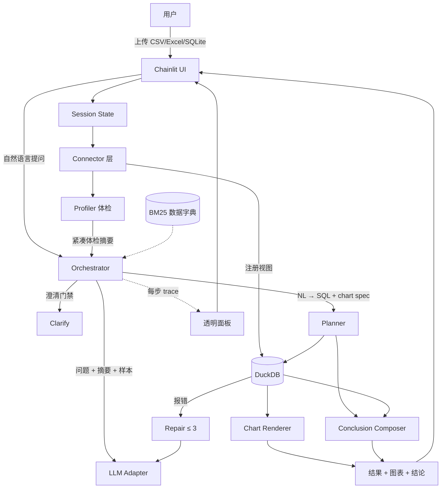

# Prizm

对话式数据分析 Agent：上传 CSV / Excel / SQLite，用自然语言提问，得到**可信**的数据结论。

Prizm 主打“可信优先”：上传后主动体检、发现异常先澄清、分析过程与 SQL 全透明，而不是只给一个黑箱数字。

## 核心能力

- **数据体检**：行列/类型/缺失/分布/样本，重复行、主键重复、脏数值格式检测
- **对话式分析**：自然语言 → 只读 DuckDB SQL → 结果表格 + 结构化图表 + 结论
- **澄清门禁**：数据异常未确认口径、问题模糊时先反问，不擅自决策
- **自修复**：SQL 解析/执行失败后带错误回传重新规划，总尝试最多 3 次
- **多轮上下文**：数据集只加载一次，追问时注入上一轮问题/SQL/结果摘要
- **RAG 数据字典**：可上传 `.md/.txt` 说明文档，术语问题走 BM25 检索并返回出处
- **透明面板**：展示执行状态、生成 SQL、引用的体检结论、已确认口径、图表/结论/修复记录

## 架构



## 快速开始

### 本地运行

需要 Python 3.11+ 与 [uv](https://docs.astral.sh/uv/)。

```bash
uv sync
cp .env.example .env
# 编辑 .env：PRIZM_DEFAULT_MODEL、PRIZM_LLM_API_BASE、对应 provider 的 API key
uv run chainlit run app/main.py
```

不填 key 时默认 `PRIZM_DEFAULT_MODEL=mock`，可离线体验上传、体检、澄清与 SQL 链路。

### Docker

```bash
docker build -t prizm .
docker run --rm -p 8000:8000 --env-file .env -v prizm-data:/data prizm
```

加固运行（只读根文件系统、无特权）：

```bash
docker run --rm -p 8000:8000 --env-file .env \
  -v prizm-data:/data \
  --read-only --tmpfs /tmp \
  --cap-drop ALL --security-opt no-new-privileges \
  prizm
```

- `.env` 不会打进镜像，key 只在运行时通过 `--env-file` 注入
- 每日 token 台账落在 `/data/usage.sqlite3`，用 volume 持久化
- 镜像内置 Noto CJK 字体，图表中文不会显示方框
- 受限网络构建时可覆盖镜像源：
  `docker build --build-arg PYTHON_IMAGE=<python:3.11-slim 镜像> --build-arg PIP_INDEX_URL=<pip 源> -t prizm .`

### 使用流程

1. 上传一个 CSV / Excel `.xlsx` / SQLite 文件，可同时上传 `.md/.txt` 数据说明
2. 查看自动体检报告与数据字典
3. 直接提问，例如“按渠道统计已完成订单的销售额，并从高到低排序”
4. 出现异常口径或模糊问题时选择澄清选项
5. 得到结论、图表、SQL、结果表与透明面板

## 数据源

| 数据源 | 支持格式 | 说明 |
|---|---|---|
| CSV | `.csv` | UTF-8(BOM) → GBK 启发式解码 |
| Excel | `.xlsx` | 多工作表时由用户选择；不支持旧版 `.xls` |
| SQLite | `.sqlite` / `.sqlite3` / `.db` | 只读连接；多表时由用户选择一张 |

Excel / SQLite 当前一次只加载一张表，不支持多表关联；详见 `docs/debts.md` 的 DEBT-021。

## 可信与安全

- **只读执行**：DuckDB parser 判定单条 SELECT，并拦截写操作与危险表函数；外部访问关闭
- **不执行自由代码**：分析走 SQL-first；pandas 仅用于结果整形与图表渲染
- **资源限制**：DuckDB `memory_limit` / `threads` / SQL 超时
- **密钥策略**：key 只从环境变量读取，不落盘、不打日志、不进仓库
- **额度控制**：每日 token 上限 + 单会话提问次数上限；台账落 SQLite，重启不清零
- **透明可审计**：每轮展示 SQL、执行状态、引用的体检结论、图表与结论来源

## 评测

当前评测集为 150 题，覆盖 3 个数据集（订单明细 / 月度销量 / 渠道流量）及各自的脏数据变体：

- 五类任务全覆盖：cleaning / aggregation / trend / attribution / multi_turn；含 12 条异常口径澄清场景
- 多轮任务用 `session` 字段串接同一会话上下文
- 标准答案由独立 pandas 脚本 `eval/build_tasks.py` 计算生成，单测校验任务文件与脚本一致；异常检出预期见 `eval/anomaly_expectations.json`

下表为 2026-11-24 全量 150 题真实模型结果（模型 `openai/glm-4-flashx-250414`）：

| 指标 | 结果 | 目标 | 状态 |
|---|---|---|---|
| 代码一次执行成功率 | 98.0%（147/150） | ≥ 75% | 达标 |
| 自修复后总成功率 | 99.3%（149/150） | ≥ 90% | 达标 |
| 数据异常检出率 | 100%（12/12） | 100% | 达标 |
| 澄清触发正确率 | 100%（150/150；异常召回 12/12） | ≥ 85% | 达标 |
| RAG 引用溯源准确率 | 100%（50/50） | ≥ 90% | 达标（模板问法） |

唯一失败题为 ord-021（差值题偶发只返回单边值，已登记 DEBT-026）。本轮用独立 pandas 复核并修正了 tra-043 标准答案：原 1744 与“cost 最高的两个渠道”口径不符，修正为 949；其余标准答案未为指标修改。

复现：

```bash
# 需要真实模型 key
uv run python -m eval.build_tasks
uv run python -m eval.run_eval --execute
uv run python -m eval.run_clarify
uv run python -m eval.run_rag
```

## 测试

```bash
uv run pytest
```

单测与集成测试默认排除 `eval` 标记；真实模型评测是统计性任务，单独运行。

## 目录结构

```text
app/main.py                 Chainlit 入口
src/prizm/
  agent/                    orchestrator / planner / clarify / repair / memory / composer / trace
  datasource/               CSV / Excel / SQLite connector
  engine/                   DuckDB 只读执行
  profiling/                数据体检
  rag/                      BM25 数据字典
  viz/                      chart spec → PNG
  utils/                    token 台账（内存 / SQLite）
eval/                       评测集、指标与执行入口
tests/                      unit + integration
docs/                       需求、架构、进度、技术债、待办
```

## 已知限制

- 差值类问题偶发只返回单边值（本轮 1/150，DEBT-026）
- 用户自带 Key 的会话输入经评估废弃，不再实施（DEBT-027 已取消）
- RAG 50 条为模板生成问法，不代表真实用户同义/口语化提问（DEBT-019）
- 图表最多展示前 50 个数据点，暂不支持多序列/面积图（DEBT-022）
- LLM 结论质量尚未纳入评测，失败时回退模板（DEBT-023）
- Excel/SQLite 仅单表、CSV 编码为启发式回退（DEBT-021/003）

完整技术债见 [docs/debts.md](docs/debts.md)。
