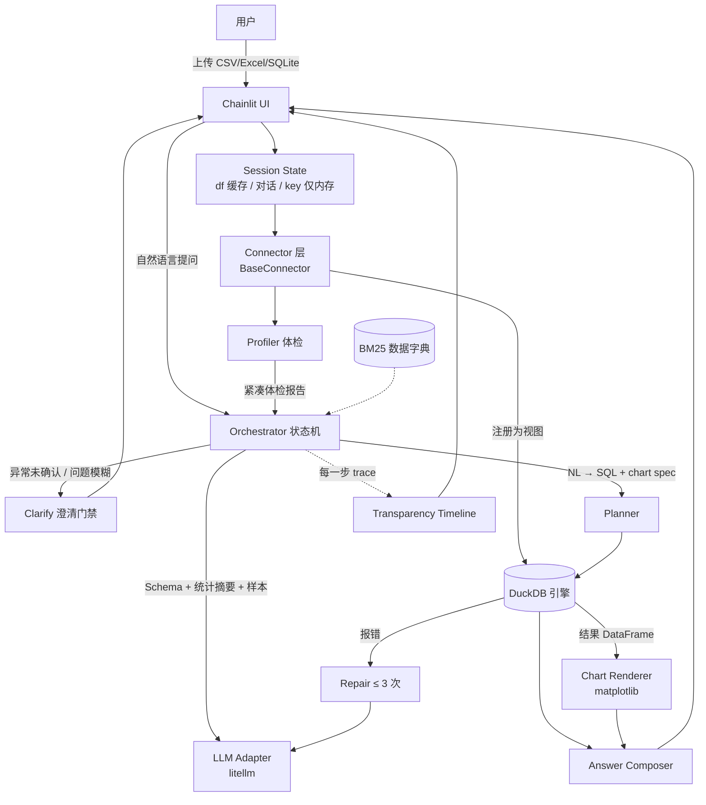

# Prizm 架构说明

> **格式契约（AI 必读，禁止修改本节）**
> - 用途：记录技术栈、模块职责、模块间契约、架构决策。新会话据此理解项目结构。
> - 写法：增量修改对应小节；"关键决策与取舍"一节**只许追加**，旧决策被推翻时标记"已被 ADR-YYY 取代"，不许删除或改写原条目。
> - 契约以代码为准：本文件只写接口签名和指向代码的路径，禁止在这里复制大段实现；改了接口必须在同一任务内同步更新本文件。
> - 技术栈如需变更先经我确认。
> - 禁止修改本格式契约。
> - 本文是**决策真相**：记录选型、理由、被否备选与不可违背的约束。
> - 依赖/版本以 `pyproject.toml` 为**唯一权威**（机器真相），本文不重复依赖清单，只描述取舍。
> - 需求来源：`docs/requirements.md`。

## 1. 定位与指导原则

对话式数据分析 Agent：上传表格 → 自然语言提问 → 得到**可信**的数据结论。

核心差异化是**可信优先**，它反过来约束了架构的三个硬要求：

1. **可审计**：业务用户要能看懂“怎么算出来的”，而不是一段黑箱代码。
2. **安全**：执行用户/模型产生的逻辑时，攻击面必须尽量小。
3. **可澄清**：体检发现的异常、模糊的问题，必须先反问，禁止擅自决策。

## 2. 技术栈（调整版）

在需求文档“锁定”项基础上，明确了以下调整：

| 层 | 采用 | 关键调整 / 理由 |
|---|---|---|
| 语言 | Python 3.11+ | pandas / litellm / UI 生态绑定 |
| 包管理 | uv（`pyproject.toml` + `uv.lock`） | 可复现、CI/Docker 友好 |
| **执行引擎** | **DuckDB（SQL-first）+ pandas（结果/绘图/兜底变换）** | **调整**：原“生成 pandas 代码再 exec”改为 SQL 优先，见 ADR-0001 |
| UI | **Chainlit** | **调整**：原 Streamlit 改为 Chainlit，贴合“Agent + 透明步骤时间线”，见 ADR-0002 |
| LLM 接入 | **litellm**，包在自有 `llm/adapter` 之后 | 保留 litellm（多 provider + 成本统计），但隔离其抽象，见 ADR-0003 |
| 数据源 | CSV / Excel（openpyxl，`.xls` 走可选 `xlrd`）/ SQLite（stdlib），`BaseConnector` 抽象 | 见 ADR-0005 |
| 体检 profiler | 自研 pandas profiler（紧凑、可注入、可单测） | 不用 ydata-profiling/sweetviz |
| 沙箱 | SQL 路径用 DuckDB 限额；pandas 兜底用子进程 + AST/import 白名单 + 超时；Docker 兜底隔离 | 见 ADR-0004 |
| 检索 | **BM25 起步**；向量 + rerank 设为可选 extra | **简化**：不默认上三件套，见 ADR-0006 |
| 图表 | matplotlib（Agg）→ PNG，输入为 **chart spec** 而非代码 | 模板化渲染，避免任意绘图代码 |
| 配置/密钥 | pydantic-settings + `.env`；key 只读 env | 不落盘、不打日志 |
| 测试/评测 | pytest（单测/集成）+ 独立 `eval/`（统计性，默认不进 CI） | 见第 6 节 |
| 容器 | Dockerfile（非 root、`/data` 持久化、支持只读根文件系统；仅 LLM 需出网） | 兼作运行隔离；见 ADR-0008 |

评估后选用 LangChain 优化：`llm/langchain_adapter.py` 用 `ChatLiteLLM` 实现同一个 `LLMAdapter` 协议；分析链路由 `agent/graph.py` 的 LangGraph `StateGraph` 编排（澄清走 `interrupt`/`Command(resume)`，`MemorySaver` checkpointer 保存状态，进度走 `stream_mode="custom"`），`Orchestrator` 只保留数据字典路由与对外 API，见 ADR-0009/ADR-0010。

## 3. 架构总览



## 4. 核心链路（P0）

1. **接入**：Connector 把 CSV/Excel/SQLite 读取并注册为 DuckDB 视图（SQLite 用 stdlib `sqlite3`/pandas 读出后注册，避免扩展联网下载）。
2. **体检**：Profiler 产出紧凑报告（行列/类型/缺失/分布/重复分主键/脏格式/5 行样本），作为 prompt 上下文注入。
3. **澄清门禁**：Orchestrator 在生成前判断——体检存在未确认异常、或问题有多种解读 → 反问，不进入执行。
4. **规划**：LLM 输出 **DuckDB SQL** + 可选 **chart spec**（类型/x/y/聚合/标题），不产出可执行 Python。
5. **执行**：DuckDB 以只读连接执行，启用 `memory_limit` / `threads` / 超时。
6. **自修复**：报错 → 格式化错误回传 → 重新生成 SQL，总尝试最多 3 次（含首次，首次失败后最多再修复 2 次）。
7. **呈现**：结果 DataFrame → chart spec 渲染 PNG → Answer Composer 汇总“结论 + 图 + 依据”。
8. **透明**：每一步写入 trace（引用了哪些体检结论、生成的 SQL、执行状态），在 Chainlit Step 中展示。

> pandas 仅用于：结果整形、绘图数据准备，以及少数 SQL 无法表达的复杂变换（走受限沙箱，见 ADR-0004）。**默认路径不执行自由代码**。

## 5. 关键决策与取舍（ADR 摘要）

### ADR-0001 执行范式：SQL-first（DuckDB）
- **决策**：核心分析由 LLM 生成 SQL、DuckDB 执行；不默认生成并 exec 自由 Python。
- **理由**：SQL 可读可审计，直接服务“可信/透明”；沙箱面从“任意 Python”降为“只读查询 + 限额”，安全成本骤降；聚合/趋势确定性好、更快。
- **被否**：① 自由 pandas exec——安全面最大、业务用户看不懂；② 纯工具 DSL / function calling——最安全但覆盖 50 个评测任务更难。
- **代价**：复杂变换/自定义逻辑仍需兜底 Python；已用“引擎接口 + 受限沙箱”隔离。
- **重估条件**：评测显示 SQL 无法覆盖的任务占比过高时，扩大受限 pandas 通道或引入工具 DSL。

### ADR-0002 UI：Chainlit
- **决策**：聊天与透明面板用 Chainlit，弃 Streamlit。
- **理由**：原生 step / 流式 / 中间步骤可折叠，正好对应“过程透明时间线”；Streamlit 整脚本 rerun 模型对长链路 Agent 的实时步骤展示很别扭。
- **被否**：Streamlit（演示快但状态/流式折腾）、Gradio（可用但步骤展示不如 Chainlit 原生）。
- **代价**：生态/示例少于 Streamlit；需求文档中“Streamlit 侧边栏”改为 Chainlit 步骤面板（功能等价）。
- **重估条件**：需要更复杂布局 / 多页时，评估 Gradio 或 FastAPI + 轻前端。

### ADR-0003 LLM 抽象：litellm（隔离在其后）
- **决策**：保留 litellm，但只在 `llm/adapter.py` 内使用，业务代码只依赖自有接口。
- **理由**：多 provider（Qwen/GPT/Claude）+ streaming + 成本统计能满足“换模型只改配置”“额度上限”。
- **被否**：裸 `openai` SDK + `base_url` 映射——更轻，但 Claude 原生非 OpenAI 兼容，多 provider 摩擦更大。
- **代价**：依赖较重、版本迭代快；用 adapter 收敛，便于日后替换为薄适配层。

### ADR-0004 沙箱与资源限制
- **决策**：分两条路径。SQL 路径用 DuckDB `memory_limit`/`threads`/超时 + 只读连接；pandas 兜底走独立子进程 + AST/import 白名单 + 超时；生产环境用 Docker（禁网、只读、`setrlimit`）做真隔离。
- **理由**：默认路径不执行自由代码，安全成本已大幅下降；兜底路径仍守住“禁网禁写 + 资源上限”。
- **代价**：Windows 下 `setrlimit` 不可用，开发期资源限制为尽力而为；在 README 注明以容器为准。

### ADR-0005 Connector 契约（先定引擎，再定接口）
- **决策**：`BaseConnector` 约定返回“可注册到 DuckDB 的数据源”，而非单纯 DataFrame。
- **理由**：先把引擎定死为 DuckDB，Connector 才能与之对齐；SQLite 通过 stdlib 读出后注册，避免运行时扩展联网。
- **扩展**：新增数据源继承 `BaseConnector`，只需实现“产出关系 / 注册视图”。

### ADR-0006 检索：BM25 起步，向量/rerank 可选
- **决策**：默认只上 BM25 + 原文出处；向量与 rerank 放 `vector` extra，按评测再启用。
- **理由**：数据字典语料小，混合检索 + rerank 对小语料增益有限却带来延迟/依赖；第 7 节指标是“引用溯源准确率”，更依赖返回带出处的原文片段。
- **代价**：极端同义/口语化查询召回可能不足；用评测数据决定是否启用向量。
- **重估条件**：术语 QA 召回不达标时启用 `vector`。

### ADR-0007 结果呈现：结构化 chart spec + LLM 结论（模板兜底）
- **决策**：Planner 只输出结构化 chart spec（bar/line/pie/scatter + x/y/title），`viz/charts` 校验后用 matplotlib Agg 渲染 PNG；结论由 `ConclusionComposer` 基于问题、SQL 与前 10 行样本让 LLM 归纳，失败/额度不足/空输出回退模板文本。
- **理由**：延续 SQL-first 的“无自由绘图代码”，图表输入可审计；结论生成与 SQL 执行解耦，模型失败不阻断已算出的结果。
- **被否**：让 LLM 直接写 matplotlib 代码——安全面失控；只返回表格——不满足 P0 的“图表 + 结论”。
- **代价**：真实模型多一次调用；结论质量尚未纳入评测，中文字体依赖系统字体（见 DEBT-022/023）。
- **重估条件**：需要对外报告结论质量，或图表类型/多序列需求扩大时。

### ADR-0008 部署：SQLite 用量台账 + 非 root 只读容器
- **决策**：每日 token 台账用 stdlib `sqlite3` 持久化，路径由 `PRIZM_USAGE_LEDGER_PATH` 指定；Docker 基于 `python:3.11-slim` + `uv.lock` 安装，内建 Noto CJK 字体，非 root 运行，`/data` 持久化，支持 `--read-only --tmpfs /tmp`；litellm 强制 `LITELLM_MODE=PROD`、使用本地成本表。
- **理由**：保留单机 demo 的低运维成本，同时解决重启清零与容器环境 `.env` 泄漏；镜像源可用 build args 覆盖，适配受限网络。
- **被否**：继续内存台账——重启清零；引入 Redis/Postgres 台账——MVP 增加服务依赖；把 key 打进镜像——违反密钥不变量。
- **代价**：跨主机多副本需共享 `/data` 卷；CJK 字体使镜像增大约 90MB；`--read-only` 需要额外 tmpfs。
- **重估条件**：多主机/多租户部署，或需要按费用精确计量时。

### ADR-0009 编排迁移：LangGraph 骨架（混合式）
- **决策**：新增 LangGraph `StateGraph` 作为编排骨架（`agent/graph.py`：clarify → plan → execute →（条件边重试）→ chart → conclude → finalize），并新增 `llm/langchain_adapter.py` 用 `ChatLiteLLM` 实现既有 `LLMAdapter` 协议；领域模块（profiler / planner / repair / engine / charts / composer / trace）保留为节点内核，`Orchestrator` 对外签名暂不变。
- **理由**：评估后选用 LangChain 优化，把“编排”换成显式状态图与条件边，便于表达澄清短路、失败重试与后续 human-in-the-loop/持久化；领域模块与既有 `LLMAdapter`/`Orchestrator` 契约保持不变，回归面可控。
- **被否**：① 全面 LangChain 化（prompt/输出解析/RAG/记忆全部换原生组件）——回归面大、评测指标风险高；② 只加依赖不改代码——无法在代码层验证状态图能力。
- **代价**：骨架阶段重试边与 `Repairer` 逻辑重复；暂未接入 HITL `interrupt`、checkpointer 与图级流式；未替换 Orchestrator（见 DEBT-028）。
- **重估条件**：需要把图接入 `Orchestrator`/`app`/`eval` 真正替换旧编排，或要展示 human-in-the-loop 与持久化记忆时。
- **更新**：其中“未接入 interrupt/checkpointer/流式、未替换 Orchestrator”的限制已由 ADR-0010 取代。

### ADR-0010 LangGraph 接入主链路（interrupt + checkpointer + custom stream）
- **决策**：`Orchestrator` 改为图的薄封装：`ask` 用新 `thread_id` invoke 图，`resolve` 用 `Command(resume=...)` 恢复；澄清在 `clarify_ask` 节点用 `interrupt` 暂停，逐项确认后继续。checkpointer 用 `MemorySaver(serde=JsonPlusSerializer(pickle_fallback=True))`，允许暂停时保存 DataFrame 等对象；有 `progress` 回调时用 `graph.stream(stream_mode="custom")` 转发 `ProgressEvent`，无回调时 `invoke`。`Answer`/`Clarification`/`format_result_table` 拆到 `agent/results.py` 以避免循环依赖；BM25 另加 `rag/langchain_retriever.py` 的 `BaseRetriever` 封装。
- **理由**：把澄清、条件重试、多轮记忆做成显式图状态与可恢复暂停，主链路仍保持单进程同步语义；对外 API 与 363 项既有单测不变，新增测试覆盖恢复与流式。
- **被否**：① 保留旧 `Repairer` 作为唯一执行路径——图只剩包壳，体现不出状态机/恢复能力；② 用持久化 checkpointer（`SqliteSaver`）——MVP 单进程，先控制依赖与复杂度。
- **代价**：图内条件重试与 `Repairer` 逻辑重复；checkpointer 为进程内且以 pickle 兜底存 DataFrame；150 题真实模型复跑需 key/额度，尚未在本轮执行（见 DEBT-029）。
- **重估条件**：需要跨重启恢复会话、多副本部署，或统一重试逻辑/持久化记忆时。

## 6. 不变量（不可违背）

- **密钥**：仅来自环境变量，只存内存；不落盘、不打日志、不进仓库。
- **执行**：默认无自由代码执行；SQL 只读 + 限额；pandas 兜底必须过白名单与超时。
- **评测与单测分离**：`unit`/`integration` 确定性、可 mock LLM、进 CI；`eval` 统计性、慢、默认排除（`-m 'not eval'`）。`eval/run_eval.py --execute` 需要真实模型 key，只用于阶段性验收，不进入默认 CI。
- **单一事实源**：依赖/版本只在 `pyproject.toml`；本文只记为什么。
- **数据不重复加载**：会话内 df/关系缓存一次，多轮复用。

## 7. 与需求 / 指标映射

| 需求 | 承载模块 |
|---|---|
| P0 数据体检 | `profiling/`（自研；`eval/anomaly_expectations.json` + `run_eval` 校验埋雷集检出率 100%） |
| P0 对话式分析 | `agent/orchestrator` + `agent/planner` + `engine/duckdb` + `viz/charts` + `agent/composer` |
| P0 澄清机制 | `agent/clarify`（该问就问 / 不该问不问） |
| P1 自修复 | `agent/repair`（≤3 次） |
| P1 多轮上下文 | `agent/memory` + 会话缓存 |
| P1 RAG 字典问答 | `rag/`（BM25 起步） |
| P2 透明面板 | trace + Chainlit Step |
| 第 7 节指标 | `eval/`（成功率 / 检出率 / 澄清正确率 / RAG） |

## 8. 目录结构

```
Prizm/
├─ pyproject.toml            # 机器真相：依赖 / 版本 / 工具配置
├─ Dockerfile                # 非 root + 禁网 + 只读（兼沙箱隔离）
├─ README.md                 # 架构图 + 评测结果
├─ .env.example              # 模型 / 额度配置，不含真实 key
├─ docs/
│  ├─ Architecture.md        # 本文件：决策真相
│  └─ requirements.md        # 需求定义
├─ app/
│  ├─ main.py                # Chainlit 入口
│  └─ streaming.py           # 进度事件 → Chainlit 步骤/结论 token 桥接
├─ src/prizm/
│  ├─ config.py              # pydantic-settings
│  ├─ llm/adapter.py         # litellm 封装（stream / retry / 额度）
│  ├─ llm/langchain_adapter.py# ChatLiteLLM → 同一 LLMAdapter 协议
│  ├─ datasource/            # base / csv / excel / sqlite connector
│  ├─ engine/duckdb_engine.py# SQL 执行 + 限额
│  ├─ profiling/             # profiler / checks / models
│  ├─ agent/                 # orchestrator / graph（LangGraph 编排）/ results / clarify / planner / repair / memory / trace / composer / prompts
│  ├─ sandbox/               # policy / executor / runner（pandas 兜底）
│  ├─ rag/                   # index / retriever / langchain_retriever / ingest
│  ├─ viz/charts.py          # chart spec → matplotlib PNG
│  └─ utils/                 # logging / tokens（额度）
├─ tests/{unit,integration,fixtures}
├─ eval/{datasets,build_tasks.py,run_eval.py,run_clarify.py,run_rag.py,anomaly_expectations.json,tasks.jsonl,rag_tasks.jsonl,metrics.py}
└─ scripts/gen_data_dict.py
```

## 9. 已落地接口（阶段 1 / P0 / P1）

- `prizm.datasource.base.BaseConnector`：`load() -> pd.DataFrame`（会话内缓存一次）、`view_name: str`、`register(engine)`；新增数据源继承并实现 `_read()`。CSV 实现在 `datasource/csv_connector.py`，视图名由 `sanitize_view_name` 清洗。Excel 实现在 `datasource/excel_connector.py`：`list_excel_sheets(path)` 列出工作表，`ExcelConnector(path, *, sheet_name=None)` 用 openpyxl 只读单个 `.xlsx` sheet。SQLite 实现在 `datasource/sqlite_connector.py`：`list_sqlite_tables(path)` 列出用户表（排除 `sqlite_*`），`SqliteConnector(path, *, table)` 用 stdlib `sqlite3` 以 `mode=ro` 读取单表；默认视图名为表名。
- `prizm.engine.duckdb_engine.DuckDBEngine`：`register_dataframe(name, df)`、`execute(sql, max_rows=None) -> pd.DataFrame`、`close()`；构造参数 `memory_limit / threads / timeout_seconds`，内部执行只读校验并设 `enable_external_access=false`。`ensure_read_only_sql` 先由 DuckDB parser 判定为单条 `StatementType.SELECT`，再对去字符串/注释后的词法骨架拦截 CTE 内写操作与危险表函数。
- `prizm.llm.adapter`：协议 `LLMAdapter.complete(messages, temperature=0.0) -> Completion(text, usage)`，可选能力 `StreamingLLM.stream(messages, temperature=0.0) -> Iterator[str]`（逐块产出文本，usage 取流末尾）；`MockLLM`（默认，流式按固定片长切分）与 `LiteLLMAdapter`（`litellm` 仅在此文件内，流式用 `stream=True` + `stream_options={"include_usage": True}` 并在结束时记账），`build_llm(settings, *, response=None, ledger=None, daily_token_budget=None)` 按模型配置切换。真实模型按模型名判定 provider（qwen→dashscope / claude→anthropic / 其余→openai），只取对应 provider 的 key，缺 key 抛 `LLMConfigError`；`PRIZM_LLM_API_BASE` 显式作为 `api_base` 传给 litellm，不依赖其隐式读 `.env`；import 前强制 `LITELLM_MODE=PROD` 与本地成本表，`max_retries` 透传 `num_retries` 处理限流/抖动。传入 `ledger` 时每次调用前检查额度、调用后记录 token/费用。
- `prizm.utils.tokens`：`Usage(prompt_tokens, completion_tokens, total_tokens, cost_usd)`、`Completion(text, usage)`、`UsageLedger` 协议、`DailyUsageLedger`（进程内，线程安全）、`SqliteUsageLedger(path)`（按自然日 upsert，重启与同机多进程共享）、`SessionTurnCounter`（单会话次数限制，0 表示不限）、`QuotaExceededError`。
- `prizm.agent.clarify`：`ClarifyGate.judge(question, profile) -> ClarifyDecision(requests)` 在规划前判定是否反问；异常按类型分组（完全重复/主键重复/缺失/脏数值），仅当问题命中受影响列或聚合类词时才问；`confirm(code, choice, question=None)` 记录会话级口径，`policy_summary()` 供 planner 注入；问题模糊时可用 `LLMAmbiguityJudge` 按 JSON 判定，判定失败回退关键词启发式；`parse_ambiguity_response` 负责校验模型输出。
- `prizm.agent.memory.ConversationMemory(max_turns=5, prompt_max_chars=2000)`：保存最近轮次 `Turn(question, sql, columns, row_count, preview, chart)`，`add / clear / turns / format_for_prompt`；只注入问题、SQL、列、行数与前几行摘要，超长时优先保留最新轮次，不注入全量数据。
- `prizm.agent.trace`：`TraceStep(name, status, summary, detail)`、`ProfileReference(code, column, count, reason)`、`Trace(question, steps, generated_sql, execution_status, profile_references, confirmed_policies, attempts, elapsed_ms)`；`to_panel_markdown()` 渲染“执行状态 + 生成 SQL + 引用体检结论 + 已确认口径 + 步骤时间线”。只保存摘要与引用，不保存全量数据、样本行或密钥。
- `prizm.rag.ingest`：`DictionaryEntry(id, text, source, column)`；`build_data_dictionary(frame, profile=None, source=...)` 生成数据集概览 + 每列统计/示例/异常提示；`parse_dictionary_text(text, source=...)` 与 `load_dictionary_file(path)` 摄取 UTF-8/GBK 的 .md/.txt 说明文档并按段落/标题切片。
- `prizm.rag.index / retriever`：`BM25Index` 使用 BM25Plus + 中文二元字组/英文词切分；`DataDictionaryRetriever(default_top_k=3).search(query)` 返回带分数与名次的命中；`DictionaryQA.answer(question) -> DictionaryAnswer(text, citations)` 拼接带来源/字段的原文片段；`is_dictionary_question` 做关键词路由。`Orchestrator` 可挂载 `DictionaryQA`，术语问题不生成 SQL，直接返回可溯源片段。`prizm.rag.langchain_retriever`：`BM25LangChainRetriever(index, top_k)` 继承 LangChain `BaseRetriever`，`_get_relevant_documents` 返回含 `id/source/column/score/rank` 的 `Document`；`build_langchain_retriever(entries, *, top_k=3)` 工厂。
- `prizm.agent.planner.Planner.plan(question, view_name, frame, *, profile_summary=None, confirmed_policies=None, conversation_summary=None, repair_feedback=None) -> Plan(sql, chart)`：prompt 有体检摘要时只注入摘要（含 schema/统计/样本），否则回退为 schema + 前 5 行样本；有已确认口径时追加“用户已确认的数据口径（必须遵守）”段；有多轮摘要时追加“最近对话与结果（用于理解指代，不要臆造）”段；有修复反馈时追加“上一次尝试失败，需要修复”段；系统 prompt 约束月份输出 YYYY-MM、差值方向为前者减后者、总量/数量返回单行单列、订单数量用 COUNT(*)、WITH/CTE 必须带最终 SELECT；`parse_plan` 校验 JSON 并解析可选 chart（结构由渲染层校验）。
- `prizm.viz.charts`：`ChartSpec(type ∈ bar/line/pie/scatter, x, y, title)`、`parse_chart_spec(raw, columns) -> ChartSpec | None`、`render_chart(spec, frame, max_points=50) -> bytes`；y 列自动转数值，空结果/无非数值/饼图负值抛 `ChartError`，matplotlib 只用 Agg 与结构化 spec，不执行自由绘图代码。
- `prizm.agent.composer`：`Conclusion(text, source, fallback_reason)`、`template_conclusion(frame)`、`ConclusionComposer(llm).compose(question, sql, frame, chart=None, on_token=None) -> Conclusion`；传 `on_token` 且适配器支持 `stream` 时逐块回调文本，否则走 `complete`；prompt 只注入结果规模与前 10 行样本，LLM 失败/额度不足/空输出回退模板文本。
- `prizm.agent.progress`：`ProgressEvent(kind ∈ step_start/step/conclusion_token, name, status, summary, detail, text)`、`ProgressSink`、`TokenSink`；编排通过可选回调对外发事件，`step_start` 表示步骤开始、`step` 表示同名步骤结束，不传回调时不产生事件、行为不变。`Repairer.run(..., progress=...)` 在规划/执行/自修复阶段发开始与结束事件。
- `prizm.agent.repair.Repairer(planner, engine, max_attempts=3).run(question, view_name, frame, *, profile_summary=None, confirmed_policies=None, conversation_summary=None) -> RepairResult(plan, dataframe, attempts, history)`：总尝试不超过 3 次（含首次）；解析/校验/执行/超时错误回传错误类型与消息并重新规划，重试时保留多轮摘要；LLM 调用失败与额度超限不重试；耗尽抛 `RepairFailed(question, attempts, last_error, history)`。`format_repair_error` 不回传本机 traceback；`build_repair_feedback` 按错误类型附加提示（VARCHAR 日期先 CAST 或用 substr、缺 GROUP BY、缺 FROM、CTE 缺最终 SELECT）。
- `prizm.agent.orchestrator.Orchestrator(connector, engine, planner, *, profile_options=None, primary_key=None, clarify_gate=None, repairer=None, memory=None, dictionary_qa=None, conclusion_composer=None).ask(question, *, progress=None) -> Answer | Clarification | DictionaryAnswer`（`resolve(value, *, progress=None)` 同）：构造时只加载一次数据并体检一次，`profile`/`dataframe`/`history`/`last_trace` 暴露状态；术语问题走 `DictionaryQA` 不生成 SQL；分析交由 `agent.graph`：`ask` 用新 `thread_id` 跑图，命中澄清时返回 `Clarification` 并通过 `pending_clarification` 暴露当前项，`resolve` 用 `Command(resume=...)` 逐项恢复；有 `progress` 时用 `graph.stream(stream_mode="custom")` 转发 `ProgressEvent`，否则 `invoke`；失败时设置 `last_trace` 后抛 `RepairFailed`；`Answer` 暴露 `chart / chart_png / conclusion / conclusion_source / attempts / repaired / repair_history / trace`，`Clarification` 暴露 `trace`；`Answer`/`Clarification`/`format_result_table` 定义在 `agent.results` 并由本模块 re-export。
- `eval/run_eval.py`：`tasks.jsonl` 每行一个任务，可选 `session` 字段；同一 `session` 的任务必须连续且使用同一数据集，`execute_tasks` 复用同一 Orchestrator 串接多轮上下文（不同会话各自独立引擎，会话内触发澄清后丢弃该会话）。`--execute` 用真实模型逐题执行，单题异常记录为 `TaskOutcome.error` 且不中断整批；`matches_expected` 按标量/记录列表做启发式比对；`--outcomes` 写 JSONL，`--results` 读取 JSONL 算指标。`--execute` 拒绝 mock，支持 `--limit / --max-attempts / --ids / --diagnostics`；`--ids` 仅执行指定任务并自动展开同 `session` 的前置任务，`--diagnostics` 输出 `TaskDiagnostic`（expected/sql/columns/rows≤20/attempts/error/matched）用于失败归因；`TaskOutcome` 含 `attempts / error`，`first_pass_ok` 按“最终正确且未触发自修复”判定，澄清类任务按门禁是否正确触发判定成功。`--anomaly-expectations` 读取数据集级预期异常代码，逐数据集体检一次并覆盖“数据异常检出率”指标（分母为预期异常代码数）。`eval/build_tasks.py` 用独立 pandas 计算生成并复核 150 条任务标准答案，`tests` 校验任务文件与该脚本一致。
- `eval/anomaly_expectations.json`：映射脏数据集文件名到必须检出的异常代码集合（完全重复/主键重复/脏格式/缺失），供 `run_eval` 计算检出率。
- `eval/run_clarify.py`：复用 `eval/tasks.jsonl` 与数据集，输出异常场景召回与整体触发准确率；默认规则/启发式，不调用真实模型。
- `eval/run_rag.py`：读取 `eval/rag_tasks.jsonl` 的 50 条术语问法，按数据集生成数据字典，校验 `is_dictionary_question` 路由与 top-1 引用字段是否命中期望列，输出引用溯源准确率（目标 ≥90%）；当前模板集 50/50。
- `prizm.profiling.profiler`：`ProfileOptions(sample_rows / top_values / max_examples / dirty_ratio_threshold / max_prompt_chars)`、`profile_frame(frame, *, primary_key=None, options=None) -> ProfileReport`、`format_profile_report`（UI 展示）、`format_profile_prompt`（prompt 注入，硬上限截断）。检测缺失（NaN/空串/空白）、完全重复、疑似主键重复（未指定时按 `id` / `*_id` 自动识别）与数值脏格式（千分位/货币符/单位/百分号）。
- 入口 `app/main.py`：Chainlit 上传 CSV / Excel(.xlsx) / SQLite（可选同时上传 .md/.txt 数据说明）→ 注册 DuckDB → 生成并展示体检报告与数据字典 → 提问；Excel 多工作表或 SQLite 多表时用动作消息让用户选一个；术语问题走 RAG 展示带出处的字典片段，分析问题展示结论 + 图表（`cl.Image`）+ SQL + 结果；真实模型模式挂载 `ConclusionComposer`，mock 模式用模板结论；用量台账按 `PRIZM_USAGE_LEDGER_PATH` 落 SQLite；`app/streaming.py` 的 `run_streamed` 把同步编排放到 `asyncio.to_thread` 运行，`progress` 事件经 `asyncio.Queue` 桥接：`step_start` 创建“进行中”的嵌套 `cl.Step`、`step` 按名称更新同一个步骤、结论用 `cl.Message.stream_token` 逐字输出并在结束后按权威文本校正（回退模板时亦一致），并用侧栏 `cl.Text` 展示透明面板（执行状态、生成 SQL、引用体检结论、已确认口径、图表/结论/尝试/修复记录）；`RepairFailed` 时展示最终错误与失败面板；mock 模式返回 `SELECT * FROM "<view>" LIMIT 5`。
- 交付：`Dockerfile` 基于 `python:3.11-slim` + `uv.lock`，安装 Noto CJK 字体，非 root（uid 10001）、`/data` 持久化、`CHAINLIT_APP_ROOT=/data`，支持只读根文件系统；`README.md` 含架构图、快速开始、安全说明与最小评测结果。
- `prizm.llm.langchain_adapter`：`LangChainLLMAdapter(chat, *, ledger=None, daily_token_budget=None)` 实现 `LLMAdapter`（`complete` / `stream`），把 dict 消息转 LangChain 消息、从 `usage_metadata` 取 token、按额度台账记账；`build_langchain_llm(settings, *, chat=None, response=None, ledger=None, daily_token_budget=None)` 在 mock 模式返回 `MockLLM`，支持注入 `chat` 单测，真实模式惰性导入 `ChatLiteLLM`。类型/文本提取辅助：`extract_usage`、`extract_text`。
- `prizm.agent.graph`：`AnalysisState`（TypedDict）、`AnalysisDeps(planner, engine, frame, view_name, *, profile_summary, composer, clarify_gate, profile, memory, progress, streaming, max_attempts, conversation_summary, confirmed_policies)`、`build_analysis_graph(deps, *, memory=None, checkpointer=None)` 返回编译后的 `StateGraph`、`run_analysis_graph(question, *, deps, memory=None) -> Answer | Clarification`、`default_checkpointer()`（`MemorySaver` + pickle 兜底）、`initial_state`、`build_trace_from_state`、`build_failed_trace`、`repair_failed_from_state`。图节点：`clarify_check`（门禁判定并记录待澄清项）→ `clarify_ask`（`interrupt` 暂停，`Command(resume=...)` 恢复后逐项 `confirm`）→ plan → execute（首次成功时补写 `SQL 规划`/`自修复`/`执行` trace）→（失败且未达 `max_attempts` 走条件边回 plan）→ chart（失败只记 trace）→ conclude（composer 缺失或回退走模板；有 `progress` 或 `streaming` 时逐 token 发 `conclusion_token`）→ finalize（构造 `Answer`/`Trace` 并追加 memory `Turn`）。有进度回调时由 `Orchestrator` 用 `graph.stream(stream_mode="custom")` 转发 `ProgressEvent`，否则 `invoke`；耗尽重试由调用方抛 `RepairFailed`。
- `prizm.agent.results`：`Answer`、`Clarification`、`format_result_table`；从 `orchestrator` 拆出以避免与 `graph` 循环依赖，`orchestrator` 继续 re-export 保持旧导入路径可用。
